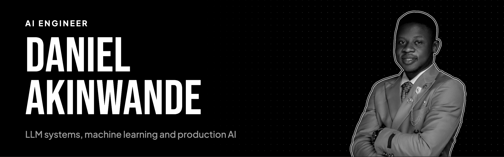

<a href="https://daniel-akinwande.vercel.app">
  <picture>
    <source media="(prefers-color-scheme: dark)" srcset="./assets/header-dark.png">
    <source media="(prefers-color-scheme: light)" srcset="./assets/header-light.png">
    
  </picture>
</a>

  <a href="https://daniel-akinwande.vercel.app"><b>Portfolio</b></a> &nbsp;·&nbsp;
  <a href="https://daniel-akinwande.vercel.app/resume.pdf"><b>CV</b></a> &nbsp;·&nbsp;
  <a href="https://linkedin.com/in/daniel-akinwande"><b>LinkedIn</b></a> &nbsp;·&nbsp;
  <a href="https://x.com/akinwande___"><b>X</b></a> &nbsp;·&nbsp;
  <a href="mailto:danielakinwande00@gmail.com"><b>Email</b></a>

I'm an AI Engineer at **VDL Technologies** in Lagos, Nigeria. I build the LLM pipelines, predictive models and APIs behind live products, with a focus on making model output accurate, unique and reliable enough to ship.

I graduated with **First Class Honours in Computer Engineering (4.57/5.0)** from Olabisi Onabanjo University as the Best Graduating Student in my department. My research covers predictive modelling, computer vision and agentic AI workflows.

| **1M+** | **190K+** | **25K** | **20+** |
| :-- | :-- | :-- | :-- |
| content records validated through production LLM pipelines | records handled by a real-time data pipeline | images scraped and catalogued with my team | participants mentored through Google Developer Student Clubs |

## What I work on

**LLM systems.** Multi-stage pipelines for generation, rewriting, validation and fact-checking, including retraining open-source models.

**AI quality.** Semantic duplicate detection, output validation and testing for failures that do not announce themselves.

**Personalisation.** Recommendation, player skill ratings, adaptive difficulty and success-rate prediction.

**Production AI.** FastAPI services, parallel workers and scheduled data pipelines, using Docker, AWS and SQL.

## Selected work

| Project | What it does | Result | Links |
| :-- | :-- | :-- | :-- |
| **AI Content Pipelines** | Six-stage LLM system for generation, rewriting, fact-checking, deduplication and personalised delivery | **1M+** validated records, in production | [Case study](https://daniel-akinwande.vercel.app/projects/ai-trivia-content-pipelines) |
| **Face Drowsiness Detection** | Real-time webcam alert system using OpenCV, dlib landmarks and Eye Aspect Ratio | Separates blinks from sustained eye closure | [Code](https://github.com/Danakin01/drowsiness_detection) · [Case study](https://daniel-akinwande.vercel.app/projects/face-drowsiness-detection) |
| **Spam Message Classifier** | Text classifier trained on 5,157 unique SMS messages, with a Streamlit app | **98.06%** accuracy, **96.77%** spam precision | [Code](https://github.com/Danakin01/email_classifier) · [Case study](https://daniel-akinwande.vercel.app/projects/spam-message-classifier) |
| **Social Media Sentiment Analysis** | NLP pipeline comparing five classifiers on 732 posts from 33 countries | **72.79%** best test accuracy | [Code](https://github.com/Danakin01/social-media-analysis-sentiment) · [Case study](https://daniel-akinwande.vercel.app/projects/social-media-sentiment-analysis) |
| **Library Resource Management System** | PHP and MySQL system that replaced manual lending at a university library | **100%** issue and return accuracy, **4.6/5** satisfaction | [Case study](https://daniel-akinwande.vercel.app/projects/library-resource-management-system) |

## Experience

| Role | Organisation | Period |
| :-- | :-- | :-- |
| **AI Engineer** | VDL Technologies | Mar 2026 to present |
| **AI and ML Lead** | Google Developer Student Clubs, OOU | 2023 to 2025 |
| **Departmental Tech Lead** | OOU-Tech Community | 2023 to 2025 |
| **Technical Intern** | VDL Technologies | May to Oct 2024 |

## Research

- **Design and Development of a Library Resource Management System: Case Study of the Engineering Campus Library.** Manuscript submitted.
- **Machine Learning Approaches for Flexural Strength Prediction in Concrete Beams.** In preparation.

## Tech stack

| Area | Tools |
| :-- | :-- |
| **Languages** | Python, SQL, C++, Java, JavaScript, PHP, MicroPython |
| **AI and ML** | PyTorch, TensorFlow, scikit-learn, NumPy, Pandas, NLTK, OpenCV, dlib |
| **LLM engineering** | Prompt engineering, fine-tuning, model retraining, agentic workflows |
| **Production** | FastAPI, REST APIs, Docker, AWS, SQL databases, parallel workers |

---

Explore the full case studies and interactive demos on [my portfolio](https://daniel-akinwande.vercel.app/work), or reach me at [danielakinwande00@gmail.com](mailto:danielakinwande00@gmail.com).
